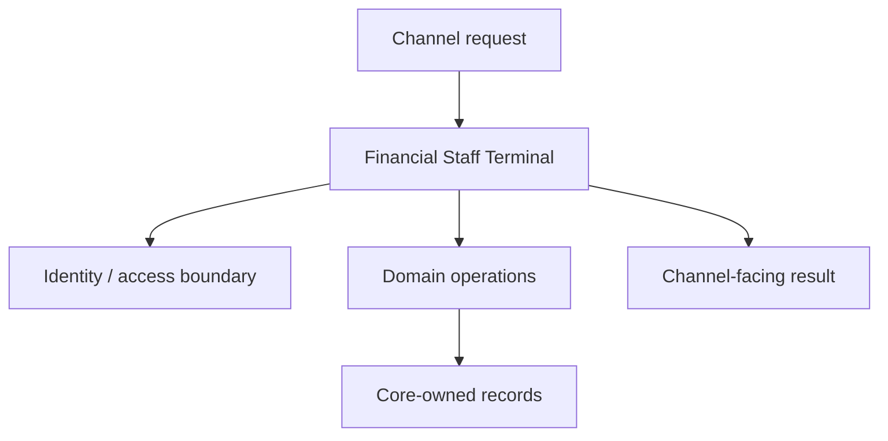

<a href="https://fireflysoftware.io/openplatform/">
<picture>
  <source media="(max-width: 640px) and (prefers-color-scheme: dark)" srcset="https://raw.githubusercontent.com/fireflysoftwaresolutions/.github/main/profile/assets/banner-narrow-dark.svg">
  <source media="(max-width: 640px)" srcset="https://raw.githubusercontent.com/fireflysoftwaresolutions/.github/main/profile/assets/banner-narrow-light.svg">
  <source media="(prefers-color-scheme: dark)" srcset="https://raw.githubusercontent.com/fireflysoftwaresolutions/.github/main/profile/assets/banner-dark.svg">
  
</picture>
</a>

# Financial Staff Terminal

Experience API for staff access to banking and lending administration in Firefly OpenPlatform.

[Current Bank owner administration](docs/current-bank-owner-administration.md) · [Platform documentation](https://docs.fireflysoftware.io/) · [Source reference](docs/openplatform/reference.md) · [Source inventory](docs/openplatform/source-inventory.json)

## Purpose, scope, and readiness

This service presents staff access to banking and lending administration to a channel. It coordinates domain calls and channel-facing request/response types while keeping business record ownership in the corresponding core services.

The current source contains the declarations indexed in the companion reference. Functional readiness is bounded by the implemented handlers, adapters, and tests; this guide does not elevate a record API, sample provider, or unexecuted test into a completed business journey.

## Business ownership and supported journeys

Resolve an employee identity and explicit staff access before exposing financial administration operations. Customer subjects must not acquire staff capabilities by presenting a record identifier.

The terminal is an experience API, not an independent accounting or lending system of record.

| Entry point | Declared operations |
| --- | --- |
| [StaffController](exp-finance-terminal-web/src/main/java/io/fireflysoftware/experience/finance/terminal/StaffController.java) | `GET /api/v1/staff/records/{area}`; `GET /api/v1/staff/records/{area}/{recordId}`; `GET /api/v1/staff/distributors`; 12 more declarations |

The complete [operation reference](docs/openplatform/reference.md#http-operations) lists each mapping and its owning method. These are source declarations; conditional beans, inherited controllers, security filters, and deployment routing can change the effective runtime API.

## Consumer example: read staff instruction views in the sandbox

Start with this repository-owned executable contract before connecting a full runtime. Use the JDK required by the effective parent, Maven, and the matching internal artifacts. The selected test defines its own collaborators; no provider credentials should be added to it. Run from this repository root:

```sh
mvn -B -pl exp-finance-terminal-core -am test -DskipOpenApiGen \
  -Dtest=InstructionDeskTest -Dsurefire.failIfNoSpecifiedTests=false
```

Runtime integration remains gated on the service configuration and selected adapters described below. The local port and bean-selection inventory below distinguishes the declared abstraction from its configured implementation. An SDK client is an outbound integration; its presence does not establish a working provider connection. Where a sandbox adapter is selected, its behavior is synthetic and limited to what that adapter implements.

This core-only fixture does not authenticate an HTTP employee. HTTP callers must supply the signed token and current resource policy described in [Staff authentication and SDK configuration](docs/staff-authentication-and-sdk.md).

**Inputs and fixture ownership.** The complete linked test class supplies its imports, setup, synthetic IDs and collaborators. Run that class as shown; the excerpt is not a standalone Java program. Synthetic adapter data is scoped to this fixture and does not seed an external owner. For a deployed call, replace fixture IDs with IDs returned by the owning record-creation API and keep tenant/parent associations intact. The request values and assertions below describe this test boundary only.

```java
@Test
    void employeeReadsTheSampleInstructionsWithoutASocket() {
        InstructionDesk desk = desk(true, new SandboxInstructionBook());
        UUID accountId = FinanceArea.ACCOUNT.primaryId();
        UUID mandateId = UUID.randomUUID();
        UUID runId = UUID.randomUUID();

        InstructionPort.Mandate mandate = desk.mandate(EMPLOYEE, accountId, mandateId).block();
        InstructionPort.StandingOrder order = desk.standingOrder(EMPLOYEE, runId).block();
        InstructionPort.DirectDebit debit = desk.directDebit(EMPLOYEE, mandateId).block();

        assertEquals("OPERATOR", mandate.role());
        assertEquals(FinanceSamples.CUSTOMER_PARTY, mandate.partyId());
        assertEquals("25.00", order.amount().toPlainString());
        assertEquals("GBP", order.currency());
        assertEquals("MANDATE-1", debit.reference());
        assertEquals("100.00", debit.amountLimit().toPlainString());
    }
```

**Expected behavior.** The sample employee reads an OPERATOR mandate, a GBP 25.00 standing-order run and a MANDATE-1 direct debit capped at GBP 100.00 from the synthetic instruction book.

**Verification and recovery.** Run the complete selected test class and inspect its Surefire result: zero failures/errors and at least one executed test are required. A skipped or zero-test build is not evidence. Compare the assertions with the owning DTO/service before extending the request. For a runtime run, separately configure authentication/entitlements and the exact downstream endpoints, migrate/seed disposable owner stores, and reread the returned identifier; these unit/contract fixtures do not establish those prerequisites.

**Execution evidence.** The selected maintained source fixture has been executed during local source qualification. Its sandbox/core collaborators do not prove a live identity provider or financial/insurance owner journey. Separate native signed-HTTP, generated-SDK and ordinary executable checks cover the corresponding boundaries; no publication is inferred.

Source of this example: [InstructionDeskTest](exp-finance-terminal-core/src/test/java/io/fireflysoftware/experience/finance/terminal/InstructionDeskTest.java).

## Architecture and repository layout



| Module | Responsibility |
| --- | --- |
| [exp-finance-terminal-core](exp-finance-terminal-core/) | Application services, handlers, and business coordination; inspect these implementations for lifecycle rules. |
| [exp-finance-terminal-web](exp-finance-terminal-web/) | HTTP entry points, boot application, and runtime configuration. |
| [exp-finance-terminal-sdk](exp-finance-terminal-sdk/) | Client artifact and OpenAPI generation configuration; build it from the matching service contract. |

## Contracts, data, authentication, and errors

Use the request and response types declared by each operation. Preserve stable record identifiers, monetary amounts/currencies, and lifecycle values when crossing a boundary. Source links below make the owned data shape inspectable without copying an unrelated service model.

| Data type | Declared fields (selection) |
| --- | --- |
| [AccessCheck](exp-finance-terminal-core/src/main/java/io/fireflysoftware/experience/finance/terminal/AccessCheck.java) | `actorId`, `action`, `resourceType`, `resourceId` |
| [AccessOutcome](exp-finance-terminal-core/src/main/java/io/fireflysoftware/experience/finance/terminal/AccessOutcome.java) | `allowed`, `reasonCode` |
| [AuditEntry](exp-finance-terminal-core/src/main/java/io/fireflysoftware/experience/finance/terminal/AuditEntry.java) | `auditId`, `employeeId`, `customerPartyId`, `reason`, `action`, `area`, `recordId` |
| [DistributorLink](exp-finance-terminal-core/src/main/java/io/fireflysoftware/experience/finance/terminal/DistributorLink.java) | `distributorId`, `recordId`, `customerPartyId`, `employeeId`, `channel`, `collaboratorId`, `area` |
| [DistributorView](exp-finance-terminal-core/src/main/java/io/fireflysoftware/experience/finance/terminal/DistributorView.java) | `distributorId`, `name`, `role`, `partyId`, `channel`, `agencyId`, `collaboratorId` |
| [MasterRecord](exp-finance-terminal-core/src/main/java/io/fireflysoftware/experience/finance/terminal/MasterRecord.java) | `type`, `id`, `code`, `name` |
| [RecordCommand](exp-finance-terminal-core/src/main/java/io/fireflysoftware/experience/finance/terminal/RecordCommand.java) | `area`, `recordId`, `customerPartyId`, `reason`, `note`, `distributorId`, `collaboratorId` |
| [StaffRecord](exp-finance-terminal-core/src/main/java/io/fireflysoftware/experience/finance/terminal/StaffRecord.java) | `id`, `area`, `customerPartyId`, `actorId`, `status`, `reference`, `distributorId` |
| [StaffSession](exp-finance-terminal-core/src/main/java/io/fireflysoftware/experience/finance/terminal/StaffSession.java) | `actorId`, `provider` |
| [SubjectRef](exp-finance-terminal-core/src/main/java/io/fireflysoftware/experience/finance/terminal/SubjectRef.java) | `actorId`, `provider` |

The [data contract reference](docs/openplatform/reference.md#data-contracts) indexes **10 DTO, record, or entity declarations** and their fields. Read DTO validation annotations together with service logic and migrations; a field's presence does not establish that every endpoint accepts it.

Every staff HTTP operation requires issuer/audience/expiration-validated RSA JWT claims tenant_id and staff_actor_id, required Jafly strict policy and a current terminal.finance resource decision. X-Actor-Id is optional compatibility data and must match the signed actor when supplied. Session username cannot authenticate or choose the employee. Existing ADMINISTER and applicable IMPERSONATE checks plus audit acknowledgment remain mandatory. See docs/staff-authentication-and-sdk.md for configuration, generated-client usage and recovery.

Examples of locally enforced failure or access behavior:

| Declared check or failure | Implementation |
| --- | --- |
| `new IllegalStateException("PROPERTY_NOT_SET")));` | [DomainConfigurationClient](exp-finance-terminal-core/src/main/java/io/fireflysoftware/experience/finance/terminal/DomainConfigurationClient.java) |
| `new TerminalDeniedException(exception.getMessage()));` | [DomainConfigurationClient](exp-finance-terminal-core/src/main/java/io/fireflysoftware/experience/finance/terminal/DomainConfigurationClient.java) |
| `new IllegalStateException("Distributor audit log was not recorded"));` | [DomainDistributorClient](exp-finance-terminal-core/src/main/java/io/fireflysoftware/experience/finance/terminal/DomainDistributorClient.java) |
| `new IllegalStateException("Distributor id was not recorded"));` | [DomainDistributorClient](exp-finance-terminal-core/src/main/java/io/fireflysoftware/experience/finance/terminal/DomainDistributorClient.java) |
| `new TerminalDeniedException("REMOVAL_NOT_APPLICABLE"));` | [StaffTerminal](exp-finance-terminal-core/src/main/java/io/fireflysoftware/experience/finance/terminal/StaffTerminal.java) |
| `new TerminalDeniedException("DRAFT_REQUIRED"));` | [SandboxRecordBook](exp-finance-terminal-core/src/main/java/io/fireflysoftware/experience/finance/terminal/SandboxRecordBook.java) |

The [security and failure reference](docs/openplatform/reference.md#security-and-failure-evidence) links local authorization annotations, status mappings, and exception sites. Framework or gateway policy is additional to this local inventory; verify the deployed filter chain and caller entitlements before integration.

## External dependencies, sandbox behavior, and replacement

The local port and bean-selection inventory below distinguishes the declared abstraction from its configured implementation. An SDK client is an outbound integration; its presence does not establish a working provider connection. Where a sandbox adapter is selected, its behavior is synthetic and limited to what that adapter implements.

Actual bean selection conditions:

| Selector | Declared in |
| --- | --- |
| `prefix = "firefly.terminal", name = "adapter", havingValue = "sandbox", matchIfMissing = true` | [TerminalWiring](exp-finance-terminal-core/src/main/java/io/fireflysoftware/experience/finance/terminal/TerminalWiring.java) |
| `prefix = "firefly.terminal", name = "adapter", havingValue = "sandbox", matchIfMissing = true` | [TerminalWiring](exp-finance-terminal-core/src/main/java/io/fireflysoftware/experience/finance/terminal/TerminalWiring.java) |
| `prefix = "firefly.terminal", name = "adapter", havingValue = "sandbox", matchIfMissing = true` | [TerminalWiring](exp-finance-terminal-core/src/main/java/io/fireflysoftware/experience/finance/terminal/TerminalWiring.java) |
| `prefix = "firefly.terminal", name = "adapter", havingValue = "domain"` | [TerminalWiring](exp-finance-terminal-core/src/main/java/io/fireflysoftware/experience/finance/terminal/TerminalWiring.java) |
| `prefix = "firefly.terminal", name = "adapter", havingValue = "domain"` | [TerminalWiring](exp-finance-terminal-core/src/main/java/io/fireflysoftware/experience/finance/terminal/TerminalWiring.java) |
| `prefix = "firefly.terminal", name = "adapter", havingValue = "domain"` | [TerminalWiring](exp-finance-terminal-core/src/main/java/io/fireflysoftware/experience/finance/terminal/TerminalWiring.java) |

Implemented adapter classes:

| Implementation | Boundary / available methods | Mode evidence |
| --- | --- | --- |
| [HttpAccessAdapter](exp-finance-terminal-core/src/main/java/io/fireflysoftware/experience/finance/terminal/HttpAccessAdapter.java) | `AccessPort`; `at`, `check` | Inspect implementation and selected wiring |
| [HttpIdentityAdapter](exp-finance-terminal-core/src/main/java/io/fireflysoftware/experience/finance/terminal/HttpIdentityAdapter.java) | `IdentityPort`; `at`, `authenticate`, `resolve` | Inspect implementation and selected wiring |
| [SandboxConfigurationStore](exp-finance-terminal-core/src/main/java/io/fireflysoftware/experience/finance/terminal/SandboxConfigurationStore.java) | `ConfigurationPort`; `getRequired`, `put`, `masters` | Synthetic adapter; collection usage found—verify persistence ownership |
| [SandboxDistributorDirectory](exp-finance-terminal-core/src/main/java/io/fireflysoftware/experience/finance/terminal/SandboxDistributorDirectory.java) | `DistributorPort`; `list`, `link`, `links` | Synthetic adapter; collection usage found—verify persistence ownership |
| [SandboxInstructionBook](exp-finance-terminal-core/src/main/java/io/fireflysoftware/experience/finance/terminal/SandboxInstructionBook.java) | `InstructionPort`; `mandate`, `standingOrder`, `directDebit` | Synthetic adapter |
| [SandboxRecordBook](exp-finance-terminal-core/src/main/java/io/fireflysoftware/experience/finance/terminal/SandboxRecordBook.java) | `StaffRecordPort`; `list`, `get`, `update`, `close`, `removeDraft` | Synthetic adapter; collection usage found—verify persistence ownership |

For a project-specific provider, implement the existing typed boundary and select it through the repository wiring. Preserve the caller-visible validation, lifecycle, error, correlation, and retry semantics; verify both successful and failed requests against the same contract. Supply endpoint/credentials through configuration. If no sandbox selector is listed, do not invent one or silently introduce sample success as a fallback.

## Configuration and local setup

Runtime configuration sources: [TerminalWiring.java](exp-finance-terminal-core/src/main/java/io/fireflysoftware/experience/finance/terminal/TerminalWiring.java), [openapi.yml](exp-finance-terminal-sdk/src/main/resources/openapi.yml), [application.yaml](exp-finance-terminal-web/src/main/resources/application.yaml).

| Environment variable or property | Declared fallback |
| --- | --- |
| `api-configuration.domain-platform.security-center.base-path` | `http://localhost:8085` |
| `firefly.terminal.security.issuer` | Empty |
| `firefly.terminal.security.audience` | Empty |
| `firefly.terminal.security.jwk-set-uri` | Empty |
| `firefly.security.resource-server.strict-policy` | `false` |
| `SERVER_PORT` | `8120` |
| `SECURITY_CENTER_URL` | `http://localhost:8085` |
| `FIREFLY_TERMINAL_ADAPTER` | `sandbox` |
| `CONFIG_MGMT_URL` | `http://localhost:8088` |
| `MASTER_DATA_URL` | `http://localhost:8089` |
| `DISTRIBUTOR_MGMT_URL` | `http://localhost:8070` |
| `BANKING_ACCOUNTS_URL` | `http://localhost:8090` |
| `ENDPOINT_DOMAIN_PAYMENTS` | `http://localhost:8092` |
| `BANKING_CARDS_URL` | `http://localhost:8091` |
| `LOAN_ORIGINATION_URL` | `http://localhost:8092` |
| `MORTGAGE_URL` | `http://localhost:8093` |
| `SUPPLY_CHAIN_FINANCE_URL` | `http://localhost:8094` |
| `COLLATERAL_URL` | `http://localhost:8095` |
| `COLLECTIONS_URL` | `http://localhost:8097` |
| `PROVISIONING_URL` | `http://localhost:8098` |
| `AML_URL` | `http://localhost:8099` |

See the [complete configuration reference](docs/openplatform/reference.md#configuration) for every placeholder and its source, including differences between profiles. A fallback is a code default, not a deployment recommendation. Secret defaults are redacted.

Build coordinates: `io.fireflysoftware:exp-finance-terminal:26.10.6`. Parent: `io.fireflysoftware:firefly-parent:26.10.6`. The POM is the compatibility source of truth.

Use the CI-declared JDK `25` and Maven available on your path. This root POM declares `java.version` / compiler release `25`; a lower source target does not lower the JDK needed to consume framework dependencies. Resolve the parent/BOM and internal SDK artifacts before launching a child module. The framework baseline comes through `firefly-parent`; provider adapters should use the corresponding Jafly modules instead of duplicating framework infrastructure.

```sh
mvn --version
mvn -B verify
```

`verify` compiles the reactor and executes the checks bound by the effective POM. A successful dependency resolution or skipped-test package is not a test result. SDK generation may require a running API specification endpoint; inspect the SDK POM before selecting its generation profile.

The current OpenPlatform parent enables `generate-openapi` when `skipOpenApiGen` is absent. Applicable web modules start an OpenAPI generation application on port **18080**, fetch `/v3/api-docs.yaml`, and stop it during the integration-test lifecycle. To validate code against the checked-in API specification without that application-startup step, use:

```sh
mvn -B verify -DskipOpenApiGen
```

This switch does not skip tests or the SDK module's own source generation. It does omit fresh application-generated OpenAPI evidence; run the complete configured lifecycle when qualifying an API change.

After dependencies and configuration are ready, build/install reactor artifacts and launch the web module:

```sh
mvn -B install
mvn -pl exp-finance-terminal-web spring-boot:run
```

Run against disposable local infrastructure first. Supply endpoint/database variables from the configuration reference; a default localhost URL does not start that dependency.

Locally declared build plugins: `maven-failsafe-plugin`, `openapi-generator-maven-plugin`, `spring-boot-maven-plugin`. Inherited checks remain governed by the parent POM.

The checkout contains **21 test source/resource files**. See the [test source index](docs/openplatform/reference.md#test-sources) for coverage locations. This inventory is not evidence that those tests passed.

CI definitions: [maven-central.yml](.github/workflows/maven-central.yml), [release.yml](.github/workflows/release.yml).

## Operations and recovery

On failure, retain the request and business record identifiers, inspect the owning controller/service and downstream status, then verify the current persisted state before retrying. Distinguish invalid input, denied access, missing records, and unavailable infrastructure. Avoid replaying a financial or externally visible action until its prior effect is known. For persistent modules, review the migration history and use the deployment rollback procedure; do not erase records to recover a failed request.

Existing test scenarios provide concrete starting points for failure reproduction:

- `readsAndWritesConfigurationAndReferenceDataThroughTheDomainSdks` — [DomainConfigurationClientTest](exp-finance-terminal-core/src/test/java/io/fireflysoftware/experience/finance/terminal/DomainConfigurationClientTest.java)
- `listReadsDistributorsFromTheDomainSdk` — [DomainDistributorClientTest](exp-finance-terminal-core/src/test/java/io/fireflysoftware/experience/finance/terminal/DomainDistributorClientTest.java)
- `linkReadsTheViewFromTheDistributorProfile` — [DomainDistributorClientTest](exp-finance-terminal-core/src/test/java/io/fireflysoftware/experience/finance/terminal/DomainDistributorClientTest.java)
- `linkDoesNotInventAViewWhenTheAuditRowIsMissing` — [DomainDistributorClientTest](exp-finance-terminal-core/src/test/java/io/fireflysoftware/experience/finance/terminal/DomainDistributorClientTest.java)
- `readsGoThroughTheDomainSdks` — [DomainInstructionClientTest](exp-finance-terminal-core/src/test/java/io/fireflysoftware/experience/finance/terminal/DomainInstructionClientTest.java)
- `mortgageUpdatePutsTheEmployeeOnTheAgreement` — [DomainRecordClientTest](exp-finance-terminal-core/src/test/java/io/fireflysoftware/experience/finance/terminal/DomainRecordClientTest.java)
- `accountUpdatePostsTheCustomerAsHolder` — [DomainRecordClientTest](exp-finance-terminal-core/src/test/java/io/fireflysoftware/experience/finance/terminal/DomainRecordClientTest.java)
- `collateralClosePostsTheClosePath` — [DomainRecordClientTest](exp-finance-terminal-core/src/test/java/io/fireflysoftware/experience/finance/terminal/DomainRecordClientTest.java)

## Compatibility and validation boundaries

Generate SDK production APIs/models/invoker support exclusively from the actual producer using the existing OpenAPI Generator. Controller tags and explicit operation IDs preserve supported names; sortParamsByRequiredFlag=false preserves original argument ordering for the optional actor header. Keep trusted principals hidden from public parameters and declare staffBearer. Handwritten SDK clients, compatibility subclasses and patched generator output are not supported. Match exact producer/SDK/deployment inputs and qualify business effects separately.

Platform and framework coordinates are enumerated in the [build reference](docs/openplatform/reference.md#build-and-dependencies). Keep the API/SDK and parent/BOM release line aligned; an omitted dependency version is managed upstream, not independently pinned here.

Documentation generation checks source freshness and local references. It does not certify compilation, test success, database migration safety, provider connectivity, regulatory approval, or end-to-end customer acceptance.

## Further reading, contribution, and license

- [Configure the finance staff terminal and its generated SDK](docs/staff-authentication-and-sdk.md)

Contributions should describe the affected business contract, update its tests and documentation together, and include the configured verification results. Review the source reference before changing public types or dependency boundaries.

Use is governed by the repository [license](LICENSE).

<!-- Maintained by .github/scripts/documentation/generate.py and curated.json. Edit editorial inputs, then regenerate. -->
